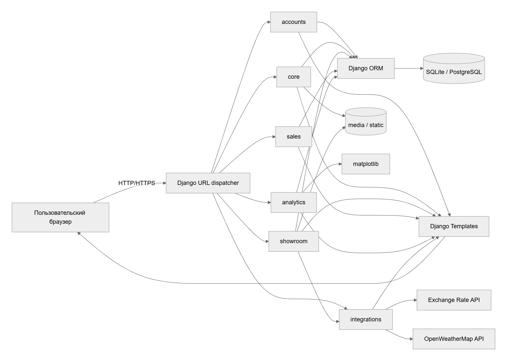
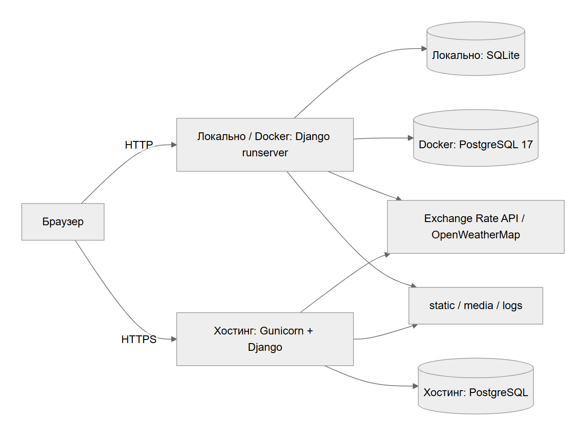

# Информационная система автосалона

## Название

**CarShowroom** — информационная система автосалона с онлайн-каталогом и оформлением заказов.

## Назначение

Автоматизация деятельности автосалона: подбор автомобиля, оформление и отслеживание покупки, обработка заказов сотрудниками, учёт остатков и продаж, публикация контента и аналитическая отчётность. Система объединяет сведения об автомобилях и заказах и уменьшает объём ручного учёта.

## Целевые пользователи

- **Гость** — неавторизованный посетитель, просматривает каталог и публичные страницы.
- **Клиент** — зарегистрированный пользователь, управляет корзиной, оформляет покупки, просматривает свои заказы и оставляет отзывы.
- **Сотрудник** — принимает заказы, подтверждает их, фиксирует оплату и выдачу автомобилей.
- **Администратор** — управляет пользователями, каталогом, контентом и промокодами через Django Admin, выполняет frontend CRUD вакансий и просматривает аналитику.

## Стек технологий

- **Язык программирования:** Python 3.13.
- **Веб-фреймворк:** Django 6.0.5, паттерн Model-View-Template (MVT).
- **Интерфейс:** HTML5, Django Templates, CSS.
- **СУБД:** SQLite для локальной разработки, PostgreSQL 17 в Docker; PostgreSQL на хостинге.
- **Контейнеризация:** Docker, Docker Compose.
- **Веб-сервер:** Gunicorn (WSGI) на хостинге; Django runserver при локальном запуске.
- **Библиотеки:** matplotlib для графиков, Requests для внешних API, Pillow для изображений, WhiteNoise для статических файлов, psycopg для PostgreSQL.
- **Тестирование:** Django TestCase, pytest, pytest-django, pytest-cov.

## Архитектура

Система представляет собой модульный монолит, использующий паттерн MVT:

- **Models:** структура данных, связи, ограничения, валидация и расчёты; работа с БД через Django ORM.
- **Views:** обработка HTTP-запросов, проверка прав, вызовы моделей и сервисов, подготовка контекста. Прикладные представления — функции; вход и выход используют стандартные представления Django.
- **Templates:** формирование HTML с общим базовым шаблоном и дочерними страницами.

**Схема основных компонентов и связей:**



[Исходник диаграммы Mermaid](diagrams/architecture.mmd)

**Схема взаимодействия компонентов при запуске:**



[Исходник диаграммы Mermaid](diagrams/deployment.mmd)

Связи моделей: [диаграмма моделей](models_diagram.md). В Docker контейнер `web` ожидает готовности `db` и подключается к нему по имени сервиса.

## Перечень модулей

- **`CarShowroom`**: Настройки, корневая маршрутизация, WSGI/ASGI, конфигурация БД, файлов и логирования.
- **`accounts`**: Регистрация, вход, профили и роли, личный кабинет, переходы статусов заказа.
- **`showroom`**: Каталог, карточка автомобиля, поиск, фильтрация, сортировка и быстрое оформление заказа.
- **`sales`**: Клиенты, сотрудники, корзина в сессии, оплата, заказы, позиции заказа и продажи.
- **`core`**: Новости, сведения о компании, FAQ, контакты, отзывы, вакансии, промокоды и политика конфиденциальности.
- **`analytics`**: Агрегация продаж, статистические показатели, прогноз и PNG-графики matplotlib.
- **`integrations`**: Получение курсов валют и погоды для тест-драйва.

Основные файлы приложений:

- `models.py` — модели, связи, ограничения и расчёты.
- `views.py` — обработка запросов и бизнес-сценариев.
- `forms.py` — формы и серверная валидация, где формы предусмотрены модулем.
- `urls.py` — маршруты.
- `admin.py` — настройка административной панели.
- `templates/` — HTML-шаблоны.
- `integrations/services.py` — HTTP-запросы к внешним API.
- `core/context_processors.py` — общие данные времени и календаря.
- `accounts/signals.py` — создание профиля при создании пользователя.

## Точки интеграции

- **База данных:** SQLite или PostgreSQL, взаимодействие через Django ORM; PostgreSQL настраивается через `DATABASE_URL`.
- **Внешние сервисы:** Exchange Rate API (`https://open.er-api.com/v6/latest/BYN`) для USD/EUR и OpenWeatherMap для погоды по городу.
- **Файловая система:** статические ресурсы в `core/static/`, загружаемые изображения и видео в `media/`, журнал в `logs/carshowroom.log`; после `collectstatic` ресурсы находятся в `staticfiles/`.
- **Сессии Django:** корзина хранится в пользовательской сессии под ключом `cart`.
- **Хостинг:** конфигурация Render в `render.yaml`, сборка в `build.sh`.

## Сборка и запуск

### Локальный запуск без Docker

Из корня проекта в PowerShell, с установленным Python 3.13:

```powershell
python -m venv .venv
Set-ExecutionPolicy -Scope Process -ExecutionPolicy Bypass
.\.venv\Scripts\Activate.ps1
python -m pip install -r requirements.txt
python manage.py migrate
python manage.py createsuperuser
python manage.py runserver
```

Сайт: `http://127.0.0.1:8000/`, административная панель: `http://127.0.0.1:8000/admin/`.

По умолчанию используется SQLite. Для погоды перед запуском установите переменную:

```powershell
$env:OPENWEATHER_API_KEY="your_openweathermap_key"
```

При отсутствии ключа отображается диагностическое сообщение. Данные каталога и контент можно добавить через Django Admin. Для создания демонстрационных продаж в отдельной учебной базе предусмотрена команда:

```powershell
python manage.py seed_demo_sales
```

### Проверки и тесты

```powershell
python manage.py check
python manage.py test
python -m pytest
```

Последняя команда запускает весь набор тестов с проверкой покрытия не ниже 70%, создаёт `htmlcov/index.html` и `coverage.xml`. Результаты и пояснения: [отчёт ЛР2](testing_lab2.md).

### Docker локально

```powershell
docker compose up --build
```

Docker Compose поднимает `web` (Django runserver) и `db` (PostgreSQL 17). При старте `docker/entrypoint.sh` ожидает БД, выполняет миграции и запускает сервер на `http://127.0.0.1:8000/`.

```powershell
docker compose exec web python manage.py createsuperuser
docker compose down
```

Том `postgres_data` сохраняет данные между запусками. Команда `docker compose down -v` удаляет этот том вместе с данными.

### Хостинг Render

В репозитории есть `render.yaml` для развёртывания из GitHub. В нём описаны Python Web Service и PostgreSQL; `build.sh` устанавливает зависимости, собирает статические файлы и применяет миграции, Gunicorn запускает `CarShowroom.wsgi:application`.

Параметры: `SECRET_KEY`, `DEBUG=False`, `ALLOWED_HOSTS`, `CSRF_TRUSTED_ORIGINS`, `DATABASE_URL`, `OPENWEATHER_API_KEY` и `LOG_LEVEL`. Загрузка локальной БД и пользовательских медиафайлов выполняется отдельно. Для добавленных на хостинге медиафайлов нужно постоянное хранилище.

## Документация лабораторных работ

- [Спецификация требований и диаграммы Use Case](requirements.md).
- [Верификация требований](verification.md).
- [Диаграмма состояний заказа](order_state_diagram.md).
- [Дефекты и расхождения](ISSUES.md).
- [ЛР2: тесты и покрытие](testing_lab2.md).
