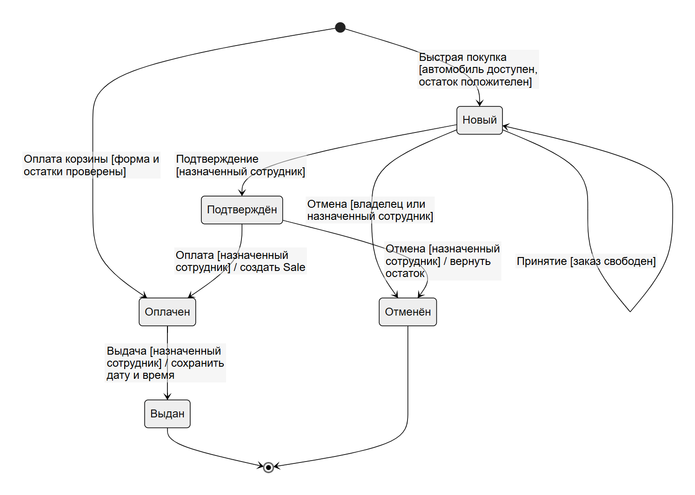

# Диаграмма состояний заказа

Сущность: `sales.models.Order`.

[Исходник диаграммы Mermaid](diagrams/order-states.mmd)

## Описание состояний

| Состояние | Значение | Смысл |
|---|---|---|
| Начальное | `[*]` | Заказ ещё не существует. |
| Новый | `new` | Заказ создан, но не подтверждён сотрудником. |
| Подтверждён | `confirmed` | Сотрудник принял и подтвердил заказ. |
| Оплачен | `paid` | Оплата зафиксирована и существует связанная `Sale`. |
| Выдан | `delivered` | Автомобиль передан клиенту; конечное успешное состояние. |
| Отменён | `cancelled` | Заказ прекращён, зарезервированный товар возвращён; конечное альтернативное состояние. |

## Инварианты переходов

- Клиент может отменить только собственный заказ в состоянии `new`.
- Сотрудник может обрабатывать только заказ, закреплённый за ним.
- В `confirmed` можно перейти только из `new`.
- В `paid` можно перейти из `confirmed` либо создать заказ сразу в `paid` после успешной онлайн-оплаты корзины.
- В `delivered` можно перейти только из `paid`.
- `delivered` и `cancelled` являются конечными состояниями пользовательского процесса.
- При отмене до оплаты остаток восстанавливается; при оплате создаётся ровно одна `Sale`.

Реализация переходов находится в `accounts.views.update_order_status`, `accounts.views.cancel_order`, `showroom.views.buy_car` и `sales.views.payment`.
