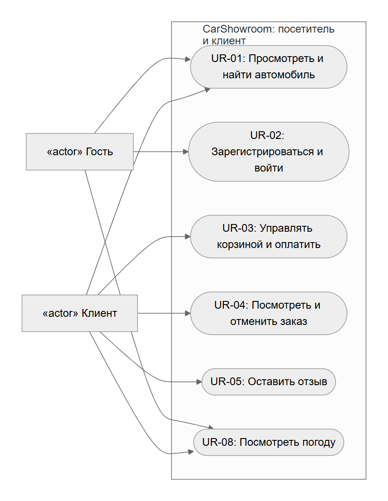
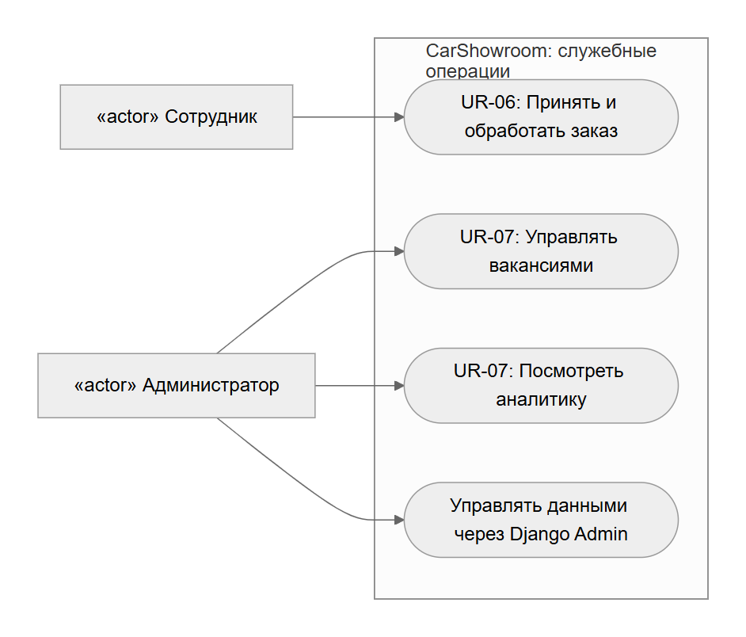
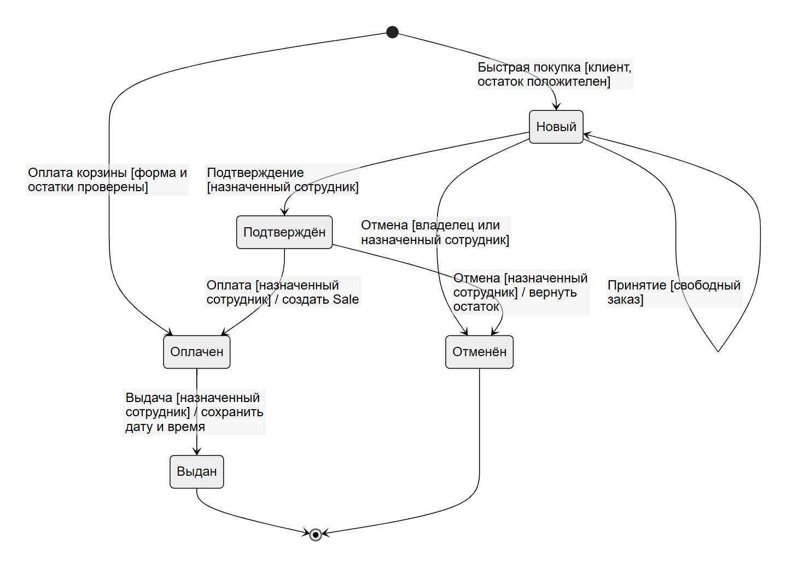

# Спецификация требований

## 1. Бизнес-требования

**Название системы:** CarShowroom.

**Назначение системы:** автоматизация деятельности автосалона: предоставление клиентам онлайн-каталога автомобилей, оформление и отслеживание заказов, обработка продаж сотрудниками, публикация информации о компании и формирование аналитической отчётности.

**Решаемые проблемы:**

- Разрозненное хранение сведений об автомобилях, клиентах, заказах и продажах.
- Ошибки ручного расчёта стоимости и учёта складских остатков.
- Отсутствие у клиента единого места для просмотра доступных автомобилей и своих заказов.
- Сложность контроля обработки заказов и анализа продаж.

**Цели:**

- Предоставить клиенту возможность найти автомобиль и оформить покупку через сайт.
- Обеспечить обработку заказа от создания до выдачи или отмены.
- Разграничить доступ клиента, сотрудника и администратора.
- Получать статистику продаж и вспомогательные данные внешних сервисов.

Бизнес-требования сохраняют идентификаторы для связи с верификацией:

| ID | Требование |
|----|------------|
| BR-01 | Система должна предоставлять единый интернет-каталог доступных автомобилей с актуальными характеристиками, ценами и остатками. |
| BR-02 | Система должна позволять клиенту оформить покупку дистанционно и получить историю своих заказов. |
| BR-03 | Система должна разделять операции посетителя, клиента, сотрудника и администратора согласно их обязанностям. |
| BR-04 | Система должна поддерживать принятие решений с помощью статистики продаж, цен в разных валютах и данных о погоде для тест-драйва. |

## 2. Пользовательские требования (Use Cases)

На диаграммах показаны роли пользователей и доступные им варианты использования. Варианты использования расположены внутри границы системы, роли — снаружи.

[Исходник диаграммы Mermaid](diagrams/use-case-client.mmd)

[Исходник диаграммы Mermaid](diagrams/use-case-staff.mmd)

На основе диаграмм выделены следующие пользовательские требования:

1. **Гость:**
   - **UR-01:** просматривать каталог и карточки автомобилей, искать и фильтровать автомобили без регистрации.
   - **UR-02:** зарегистрироваться как клиент и войти по логину и паролю.
   - **UR-08:** посмотреть погоду в выбранном городе перед тест-драйвом.
   - Просматривать публичные страницы компании, новости, FAQ, контакты, вакансии, отзывы и промокоды.

2. **Клиент:**
   - **UR-03:** добавлять автомобили в корзину, менять количество, удалять позиции и оформлять демонстрационную оплату.
   - **UR-04:** просматривать свои заказы и отменять собственный новый заказ.
   - **UR-05:** публиковать отзыв с оценкой от своего имени.
   - Пользоваться публичными функциями просмотра каталога и погоды.

3. **Сотрудник:**
   - **UR-06:** принимать свободные новые заказы, подтверждать их, фиксировать оплату, выдавать автомобили и отменять допустимые заказы.

4. **Администратор:**
   - **UR-07:** выполнять CRUD вакансий на страницах сайта и просматривать статистику продаж с графиками.
   - Управлять пользователями, каталогом, заказами, контентом и промокодами через Django Admin.

## 3. Функциональные требования (>=15)

| ID | Требование | Роль |
|----|------------|------|
| FR-01 | Система должна показывать в каталоге только автомобили с `is_available=True` и положительным остатком.  Гость |
| FR-02 | Система должна искать автомобили по части названия, фильтровать по категории и диапазону цены, сортировать по цене, году и названию; некорректные параметры не должны приводить к HTTP 500.  Гость, клиент |
| FR-03 | Система должна показывать карточку доступного автомобиля с изготовителем, категорией, ценой, остатком и характеристиками.  Гость, клиент |
| FR-04 | Главная страница должна показывать последнюю опубликованную новость и активных партнёров.  Гость |
| FR-05 | При регистрации система должна проверять email, белорусский номер телефона, достижение 18 лет и обязательные поля клиента.  Гость |
| FR-06 | Система должна поддерживать вход, выход и доступ к личному кабинету только после аутентификации.  Все |
| FR-07 | Публичная регистрация должна создавать только клиента; учётные записи сотрудников должен создавать администратор.  Гость, администратор |
| FR-08 | Система должна разрешать операции корзины и покупки только пользователю с ролью клиента и записью `Client`.  Клиент |
| FR-09 | Клиент должен добавлять, увеличивать, уменьшать и удалять позиции корзины; количество не должно превышать остаток.  Клиент |
| FR-10 | Форма оплаты должна проверять имя владельца, 16 цифр номера, срок действия, трёхзначный CVV и согласие пользователя.  Клиент |
| FR-11 | Успешная оплата должна в одной транзакции создать оплаченный заказ, позиции и продажу, уменьшить остатки и очистить корзину.  Клиент |
| FR-12 | Быстрая покупка должна создавать новый заказ только по POST-запросу и уменьшать остаток выбранного автомобиля.  Клиент |
| FR-13 | Личный кабинет клиента должен показывать его заказы и действующие промокоды.  Клиент |
| FR-14 | Клиент должен отменять только свой заказ в статусе `new`; система должна возвращать товар на склад.  Клиент |
| FR-15 | Сотрудник должен принимать только свободный заказ в статусе `new`.  Сотрудник |
| FR-16 | Сотрудник должен изменять только закреплённые за ним заказы по переходам `new → confirmed → paid → delivered`; до оплаты заказ можно отменить.  Сотрудник |
| FR-17 | При переходе заказа в `paid` система должна создать не более одной связанной продажи.  Система |
| FR-18 | Только авторизованный клиент должен добавлять отзыв; имя автора должно совпадать с его username.  Клиент |
| FR-19 | Система должна показывать только опубликованные новости и отзывы, а обычным пользователям — только активные вакансии.  Все |
| FR-20 | Администратор должен создавать, читать, изменять и удалять вакансии через Function-Based Views на сайте.  Администратор |
| FR-21 | Аналитика должна быть доступна только администратору и содержать агрегаты продаж, прогноз и графики matplotlib.  Администратор |
| FR-22 | Система должна получать курсы BYN к USD/EUR с тайм-аутом и сохранять работоспособность каталога при ошибке API.  Все |
| FR-23 | Система должна получать погоду OpenWeatherMap для указанного города и показывать понятную ошибку при отсутствии ключа или сбое API.  Все |
| FR-24 | Система должна отображать новости, логотипы и фотографии из файлового хранилища и статические ресурсы приложения.  Все |
| FR-25 | Система должна преобразовывать даты из UTC в выбранную в профиле тайм-зону и использовать тайм-зону сервера как резервную.  Все |

## 4. Нефункциональные требования (>=5)

| ID | Требование | Категория |
|----|------------|-----------|
| NFR-01 | Все операции изменения заказа, корзины, отзывов и вакансий должны требовать аутентификацию, роль и HTTP-метод согласно спецификации; неразрешённый запрос не должен изменять данные.  Безопасность |
| NFR-02 | База данных должна предотвращать дублирование телефонов и email клиентов/сотрудников, а оформление корзины должно выполняться атомарно.  Целостность данных |
| NFR-03 | Каждый запрос к внешнему API должен задавать тайм-аут соединения и ожидания данных 5 секунд и возвращать контролируемый результат при сетевой ошибке. Тайм-аут Requests не является ограничением общей длительности операции.  Надёжность |
| NFR-04 | Проект должен запускаться командами из README на Python 3.13 с SQLite и через Docker Compose с PostgreSQL 17.  Переносимость |
| NFR-05 | Команды `python manage.py check` и `python manage.py test` должны завершаться без ошибок перед выпуском версии.  Тестируемость |
| NFR-06 | События регистрации, обработки заказов и ошибок интеграции должны записываться в консоль и UTF-8 журнал с ротацией при размере 1 МиБ (1 048 576 байт) и хранением трёх архивов.  Аудит |
| NFR-07 | HTML-страницы должны использовать UTF-8, базовый шаблон, семантическую разметку и доступные подписи элементов управления.  Доступность и совместимость |
| NFR-08 | Секретный ключ, адрес БД и API-ключ погоды в развёрнутой системе должны поступать из переменных окружения, а `DEBUG` должен быть выключен.  Безопасность конфигурации |

## 5. Диаграмма состояний для сущности «Заказ»

**Описание состояний и переходов:**

- **Начальная точка:** заказ ещё не существует.
- **Создание нового заказа:** клиент оформляет быструю покупку доступного автомобиля с положительным остатком; создаётся заказ в состоянии «Новый».
- **Создание оплаченного заказа:** клиент проходит демонстрационную оплату корзины; заказ сразу получает состояние «Оплачен».
- **«Новый» → «Новый»:** сотрудник закрепляет свободный заказ за собой.
- **«Новый» → «Подтверждён»:** назначенный сотрудник подтверждает заказ.
- **«Новый» → «Отменён»:** владелец-клиент или назначенный сотрудник отменяет заказ, остаток возвращается на склад.
- **«Подтверждён» → «Оплачен»:** назначенный сотрудник фиксирует оплату, создаётся продажа.
- **«Подтверждён» → «Отменён»:** назначенный сотрудник отменяет заказ до оплаты.
- **«Оплачен» → «Выдан»:** назначенный сотрудник выдаёт автомобиль, фиксируются дата и время.
- **Конечные состояния:** «Выдан» и «Отменён».

[Исходник диаграммы Mermaid](diagrams/order-states-overview.mmd)

При отмене нового заказа остаток также восстанавливается. Взятие в работу меняет назначенного сотрудника, но не статус заказа.

Ограничение текущей реализации: онлайн-оплаченный заказ создаётся без сотрудника, а действие принятия разрешено только для новых заказов. Расхождение зарегистрировано как **ISSUE-006**. Изменение процесса назначения требует согласования FR-15.

Подробное описание сущности и переходов: [диаграмма состояний заказа](order_state_diagram.md).

**Ограничения проекта:**

- Оплата демонстрационная: взаимодействия с банком нет, реквизиты карты не сохраняются.
- Django Admin — служебный интерфейс; CRUD вакансий дополнительно реализован на пользовательских страницах.
- Требования описывают ожидаемое поведение; фактическое соответствие и открытые дефекты приведены в [верификации](verification.md) и [ISSUES.md](ISSUES.md).
